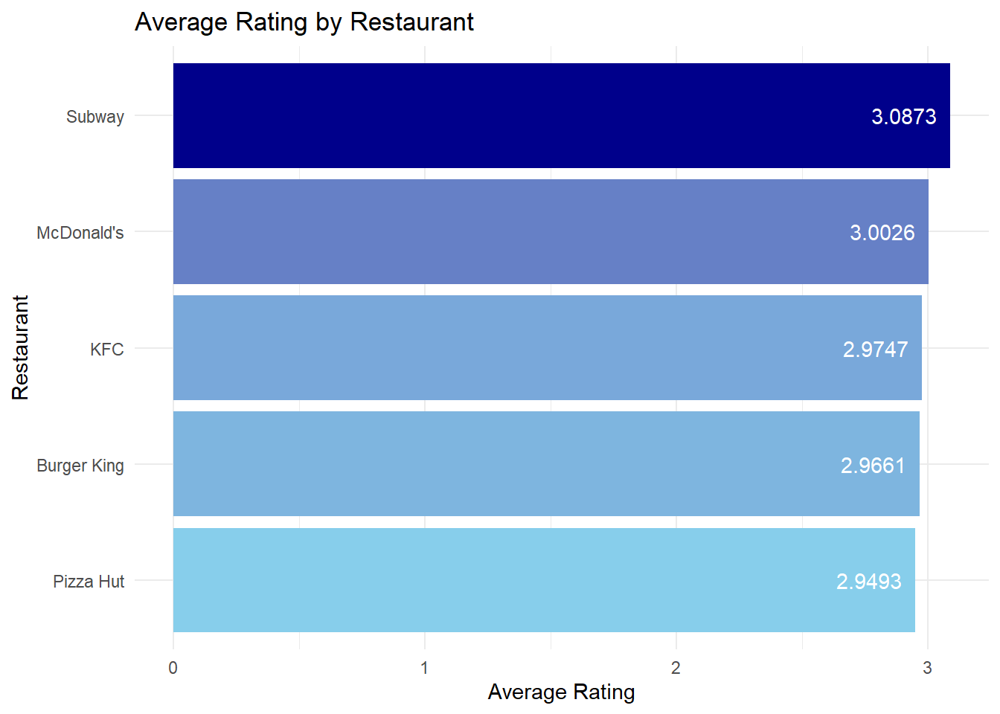
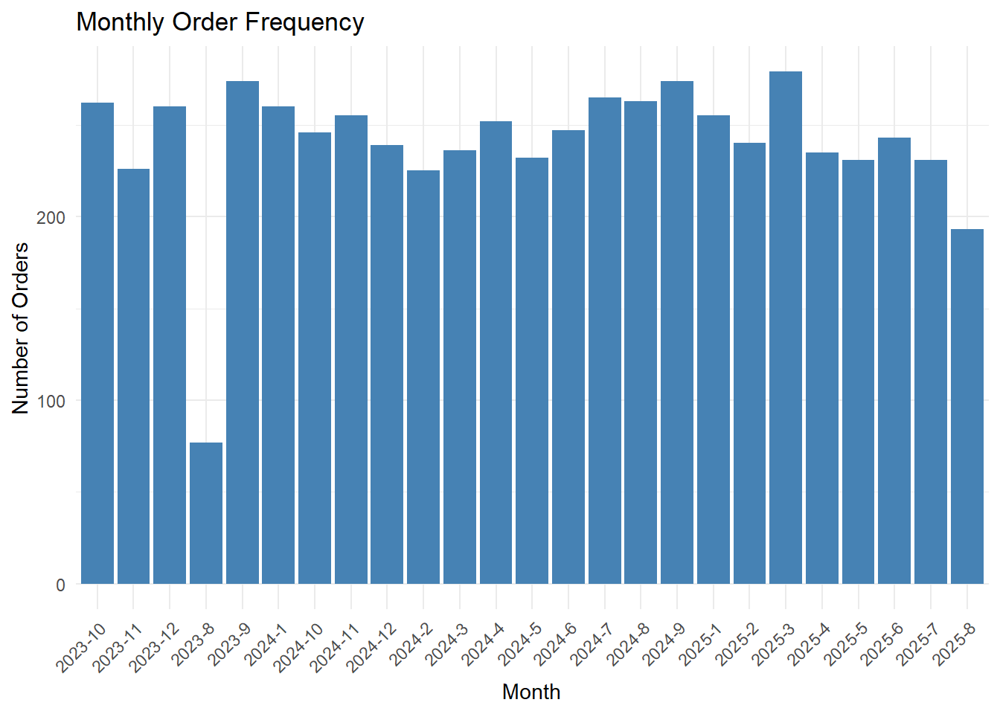
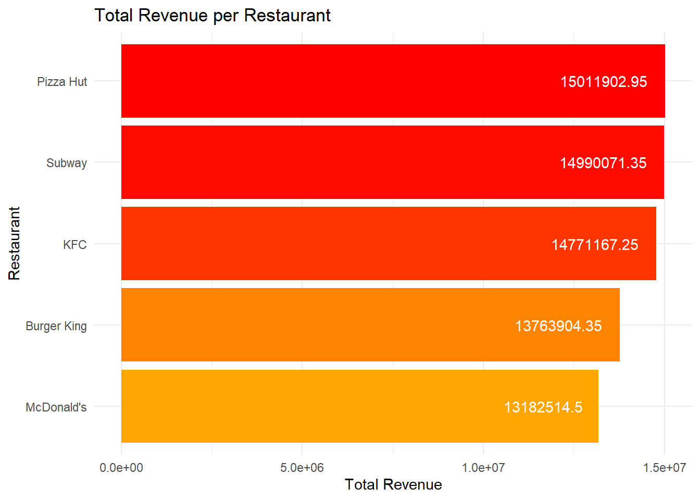
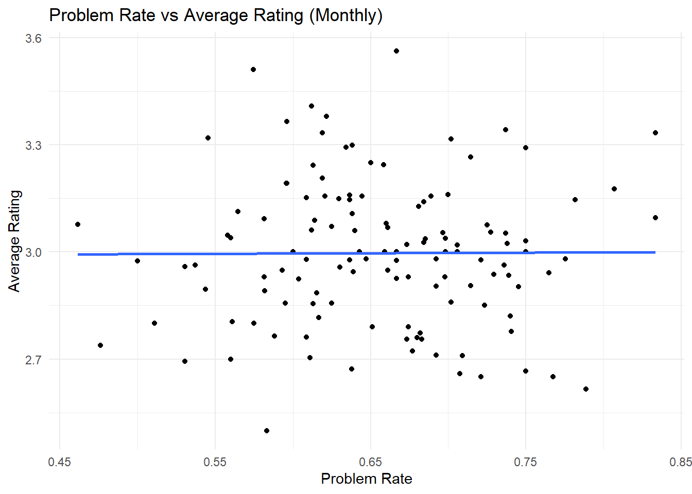
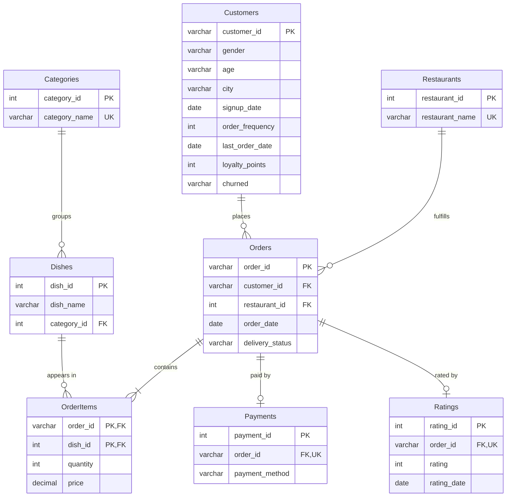

# Foodpanda Orders: Relational Database Design & Statistical Analysis

An end-to-end SQL + R project: a flat food-delivery dataset (6,000 customers, 6,000 orders, 5 restaurants,
July 2023 to mid-2025) is normalized into a **3NF MySQL schema**, then analyzed directly from the
database to ask what drives customer ratings.

**Stack:** MySQL · SQL · R (DBI/RMySQL, ggplot2, dplyr)

## Key findings

- **Ratings are not explained by anything I tested.** Delivery status, order price, loyalty points,
  age group, and restaurant volume all showed no statistically significant relationship with rating.
  - Cancelled/delayed orders vs. others: mean rating 2.997 vs 2.997 (Welch t-test, p = 0.98).
  - Monthly problem rate vs. average rating: r = 0.20, p = 0.34 (n = 25 months, R² = 0.04).
  - Loyalty points vs. rating: r = 0.009, p = 0.50.
- **Ratings look uniformly distributed** (mean about 3.0, residual SD about 1.4, which is what a uniform 1 to 5
  scale produces). Combined with evenly split demographics, this suggests the dataset is synthetic, so
  the null results are expected rather than a business insight. I report them as-is.
- **Restaurants are close:** Subway has the most orders (1,260) and the highest average rating (3.09);
  Pizza Hut leads revenue (about 15.0M) despite fewer orders than Subway.
- **Volume** is stable at roughly 220 to 280 orders a month after a partial first month.

| Avg rating by restaurant | Monthly orders |
|---|---|
|  |  |

| Revenue by restaurant | Problem rate vs. rating |
|---|---|
|  |  |

## Database design

Seven tables, normalized from a single 20-column flat file. `Orders <-> Dishes` is a many-to-many
relationship resolved through `OrderItems`.



**Constraints:** primary/foreign keys throughout; `UNIQUE` on restaurant and category names and on
`Payments.order_id` / `Ratings.order_id` (enforcing one-to-one); `CHECK` on rating (1 to 5), quantity (> 0),
price (>= 0), loyalty points and order frequency (>= 0); `NOT NULL` on keys; `ON DELETE CASCADE` from
orders to their items, payment, and rating.

**View and index:** `v_order_summary` flattens the six-table join used by most queries; indexes on
`Orders(order_date)` and `Orders(delivery_status)` support the monthly and status aggregations.
See `sql/02_views_and_indexes.sql` for the rationale.

## Reproducing the project

1. Install MySQL 8+ and R with `DBI`, `RMySQL`, `ggplot2`, `dplyr`.
2. Download the dataset from [Kaggle: Foodpanda Analysis Dataset 2025](https://www.kaggle.com/datasets/nabihazahid/foodpanda-analysis-dataset-2025) and save the CSV as `data/foodpanda.csv` (rename it if the downloaded file has a different name).
3. Run `sql/01_schema_and_load.sql` **up to and including** the `raw_foodpanda` table definition.
4. Load the CSV into the staging table:
   ```sql
   LOAD DATA LOCAL INFILE 'data/foodpanda.csv' INTO TABLE raw_foodpanda
   FIELDS TERMINATED BY ',' ENCLOSED BY '"' LINES TERMINATED BY '\n' IGNORE 1 LINES;
   ```
   The load script expects dates in `MM/DD/YYYY` format. `LOCAL INFILE` must be enabled on both
   the MySQL server and client (`SET GLOBAL local_infile = 1;`), or you can use your client's
   import wizard (e.g. MySQL Workbench's Table Data Import Wizard) instead.
5. Run the remaining `INSERT ... SELECT` statements at the bottom of `sql/01_schema_and_load.sql`,
   then run `sql/02_views_and_indexes.sql`.
6. Set the environment variables `FOODPANDA_DB_USER`, `FOODPANDA_DB_PASSWORD`, `FOODPANDA_DB_HOST`,
   and `FOODPANDA_DB_PORT`, then knit `analysis/foodpanda_analysis.Rmd`.

## Data

The raw Foodpanda customer/order dataset is from [Kaggle: Foodpanda Analysis Dataset 2025] (https://www.kaggle.com/datasets/nabihazahid/foodpanda-analysis-dataset-2025).

## Credits

Originally built as a database course capstone. 
